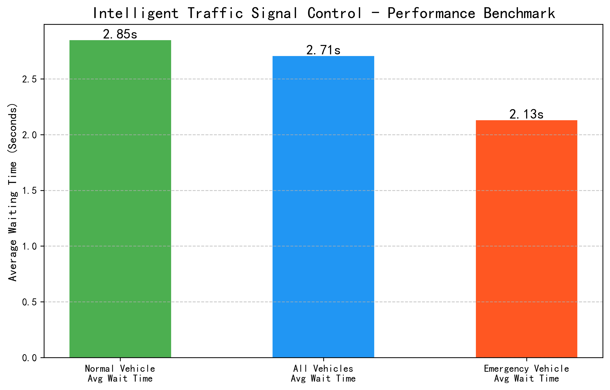

# 🚦 Intelligent Traffic Signal Control System

## 📖 Project Overview
This project implements an **adaptive traffic signal control algorithm** based on Python and SUMO (Simulation of Urban MObility) using the TraCI interface. 

Beyond standard dynamic timing based on lane queue lengths, this project specifically introduces an **Emergency Vehicle Preemption (EVP)** strategy. It ensures absolute priority for emergency vehicles (e.g., ambulances, fire trucks) while maintaining the overall efficiency of the intersection and avoiding severe traffic congestion or sudden braking.

## ✨ Key Features

- **Dynamic Signal Timing (Adaptive Control)**
  - Uses `traci.lane.getLastStepHaltingNumber()` to monitor real-time vehicle queue lengths rather than relying solely on instantaneous induction loop triggers.
  - Implements a force-maximum green light duration (e.g., 30s/40s) to prevent lane starvation and deadlocks.
  
- **Emergency Vehicle Preemption (EVP)**
  - **Global Scanning**: Scans all active vehicles and identifies emergency vehicles via `traci.vehicle.getVehicleClass() == "emergency"`.
  - **Distance-based Trigger**: Utilizes `traci.vehicle.getNextTLS()` to accurately measure the distance from the emergency vehicle to the stop line, triggering the preemption logic precisely when the vehicle is approaching.
  - **Dynamic Yellow Light Buffer**: 
    - Normal phase transitions require a standard **3-second** yellow light.
    - When preempting for an emergency vehicle, the yellow light is dynamically extended to **5 seconds**, ensuring cross-traffic safely clears the intersection to avoid rear-end collisions.

- **Data Analysis & Visualization**
  - Parses the output `tripinfo.xml` to calculate weighted average waiting times, distinguishing between normal and emergency vehicles.
  - Automatically generates a benchmark bar chart using `matplotlib`.

## 📊 Benchmark Results
Based on a 3600-second (1 hour) microsimulation with over 700 vehicles and an emergency vehicle ratio of 20%:

- **Normal Vehicle Average Waiting Time**: Optimized down to **2.85 seconds**.
- **Emergency Vehicle Average Waiting Time**: Reduced to **2.13 seconds**, showing a clear priority advantage compared to normal vehicles.



## ⚠️ Limitations & Future Work

While the current system successfully demonstrates the core concepts of adaptive traffic control and emergency vehicle preemption, there are several areas for improvement:

1. **Preemption Efficiency is Not Absolute (Main Limitation)**:
   - **Observation**: Although emergency vehicles (2.13s) wait less than normal vehicles (2.85s), the reduction is only marginal, not near-zero as ideally expected.
   - **Root Cause**: The emergency vehicle might still be blocked by the physical distance from the trigger point to the intersection, or stuck behind a queue of normal vehicles that cannot clear instantly.
   - **Future Work**: Implement **Lane-clearing protocols** (forcing normal vehicles to yield) or dynamic green wave adjustments to achieve true "zero-wait" for emergency vehicles.

2. **Single Intersection Focus**: 
   Currently, the system controls only a single isolated intersection. Future work requires **Green Wave Coordination** across multiple intersections.
   
3. **Simplified Environment**: 
   Pedestrians and cyclists are currently not considered in the simulation.

4. **Hard-coded Thresholds**: 
   The yellow light durations (3s/5s) and maximum green durations (30s/40s) are hard-coded based on empirical tuning. A more robust approach would involve **Reinforcement Learning (RL)** to dynamically optimize these parameters.

## 🚀 Getting Started

### Prerequisites
- [SUMO](https://sumo.dlr.de/docs/Downloads.php) installed and `SUMO_HOME` environment variable configured.
- Python 3.7+

### Installation & Execution
1. Clone the repository:
   ```bash
   git clone https://github.com/LeonWei826/SUMO-Traffic-Simulation.git
   cd SUMO-Traffic-Simulation
